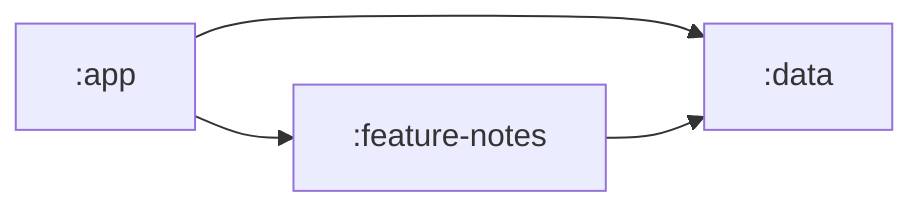
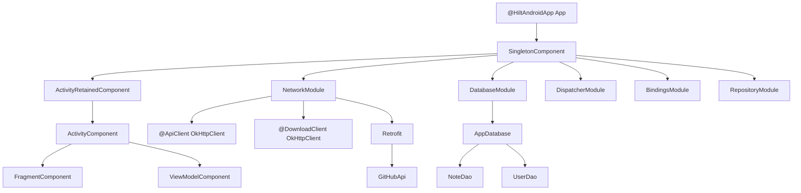
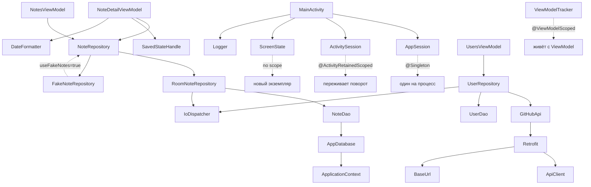
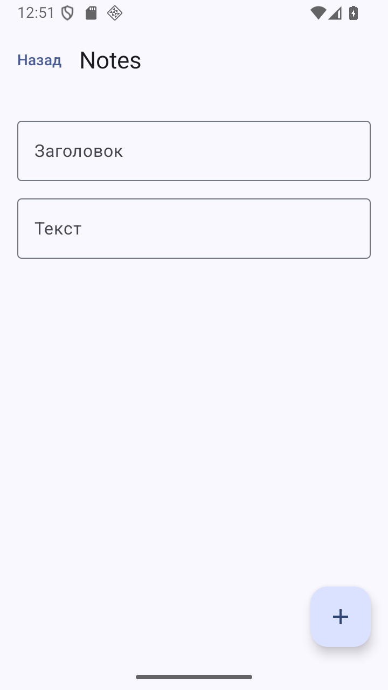
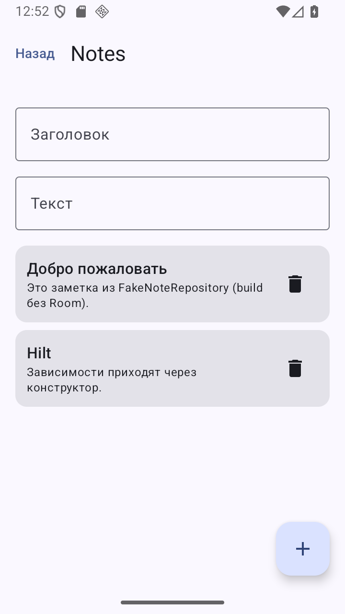
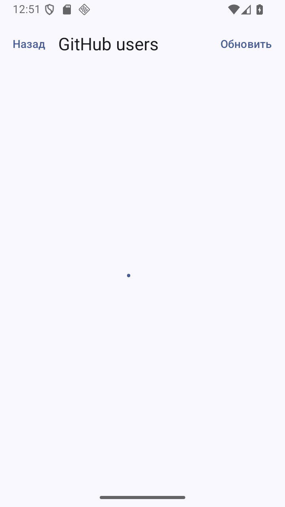
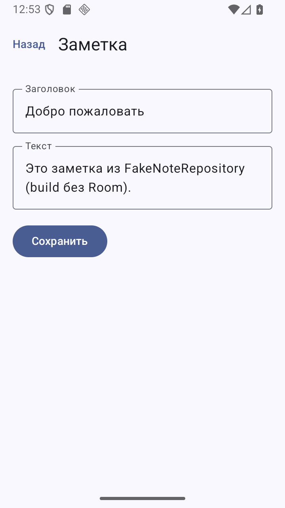

# HiltLab — Dependency Injection with Hilt

Учебный проект Practice 15: многомодульное Android-приложение с Hilt, Room, Retrofit, Compose и тестами. Показывает полный путь от ручного DI к графу зависимостей Hilt.

## Возможности

- **GitHub users** — Retrofit + Gson, кеш в Room, `@HiltViewModel`.
- **Notes** — список и детальный экран, `SavedStateHandle` для `noteId`, сохранение в Room.
- **Fake-режим заметок** — приложение работает без Room по Gradle-свойству.
- **Два `OkHttpClient`** — 10 с для API и 60 с для загрузок, выбор через `@Qualifier`.
- **Scope-демонстрация** — `@Singleton`, `@ActivityRetainedScoped`, `@ViewModelScoped` и unscoped-класс с логами создания.
- **`BootReceiver`** с `@AndroidEntryPoint` и полевой инъекцией.
- **25 JVM-тестов** и **4 instrumented-теста** (Hilt + Compose + in-memory Room).

## Стек

| Компонент | Версия |
|---|---|
| Gradle / AGP | 8.10.2 / 8.8.0 |
| Kotlin / KSP | 2.1.20 / 2.1.20-2.0.1 |
| Hilt | 2.57.1 |
| Room | 2.7.1 |
| Retrofit / OkHttp | 2.11.0 / 4.12.0 |
| Compose BOM | 2024.09.03 |
| minSdk / targetSdk / compileSdk | 24 / 35 / 35 |

Room обновлён до 2.7.1, потому что Room 2.6.1 падает на KSP2 с `unexpected jvm signature V` для `suspend`-методов DAO, возвращающих `Unit`.

## Модули

```
:app            @HiltAndroidApp, MainActivity, BootReceiver, навигация, Compose-тема
:feature-notes  NotesScreen, NoteDetailScreen, @HiltViewModel + SavedStateHandle
:data           модели, Room, Retrofit, репозитории, Hilt-модули, scopes, Logger
```

Зависимости модулей:



## Компоненты Hilt



## Граф зависимостей



## Куда что инжектится

| Класс | Как создаётся | Scope |
|---|---|---|
| `AppSession` | `@Inject constructor` | `@Singleton` |
| `ActivitySession` | `@Inject constructor` | `@ActivityRetainedScoped` |
| `ScreenState` | `@Inject constructor` | без scope |
| `ViewModelTracker` | `@Inject constructor` | `@ViewModelScoped` |
| `Logger` | `@Binds LogcatLogger` | без scope |
| `OkHttpClient` (API) | `@Provides` | `@Singleton`, `@ApiClient` |
| `OkHttpClient` (download) | `@Provides` | `@Singleton`, `@DownloadClient` |
| `Retrofit`, `GitHubApi` | `@Provides` | `@Singleton` |
| `AppDatabase` | `@Provides` + `@ApplicationContext` | `@Singleton` |
| `NoteDao`, `UserDao` | `@Provides` | без scope |
| `CoroutineDispatcher` | `@Provides` | `@Singleton`, `@IoDispatcher` |
| `NoteRepository` | `@Provides` по `BuildConfig.USE_FAKE_NOTES` | `@Singleton` |
| `UserRepository` | `@Binds DefaultUserRepository` | `@Singleton` |
| `NotesViewModel` | `@HiltViewModel` | `ViewModelScoped` |
| `NoteDetailViewModel` | `@HiltViewModel` + `SavedStateHandle` | `ViewModelScoped` |

## Запуск

```bash
# из корня HiltLab
./gradlew :app:assembleDebug
./gradlew :app:installDebug
```

Открыть в Android Studio: `HiltLab/settings.gradle.kts`. `local.properties` содержит только путь к SDK и не коммитится.

### Fake-режим заметок

```bash
./gradlew :app:installDebug -PuseFakeNotes=true
```

`USE_FAKE_NOTES` попадает в `BuildConfig` модуля `:data`; `RepositoryModule` выбирает `FakeNoteRepository` через `Provider`, поэтому в fake-режиме Room не создаётся. Без свойства используется `RoomNoteRepository`.

## Тесты

```bash
# JVM: 25 тестов, без Android и эмулятора
./gradlew testDebugUnitTest

# Instrumented: 4 теста, нужен запущенный эмулятор/устройство
./gradlew :app:connectedDebugAndroidTest
```

Покрытие:

- `ManualDiTest` — construct / supplied, fake вместо реального движка.
- `FakeNoteRepositoryTest`, `RoomNoteRepositoryTest` — репозитории и test dispatcher.
- `UserRepositoryTest` — `MockWebServer`: успех, кеш, ошибка сети.
- `NetworkQualifierTest` — таймауты клиентов, `FileDownloader`.
- `NotesViewModelTest`, `NoteDetailViewModelTest` — ViewModel и `SavedStateHandle`.
- `NoteRepositoryHiltTest` — `@TestInstallIn` заменяет `DatabaseModule` на in-memory Room.
- `ScopeTest` — singleton vs unscoped.
- `NotesScreenTest` — Compose UI.

## Скриншоты

| Режим | Экран |
|---|---|
| Room (по умолчанию) |  |
| `-PuseFakeNotes=true` |  |
| GitHub users |  |
| Детальный экран |  |

## Ответы на вопросы

Все 30 ответов, реальные логи и список ограничений — в [NOTES.md](NOTES.md).
